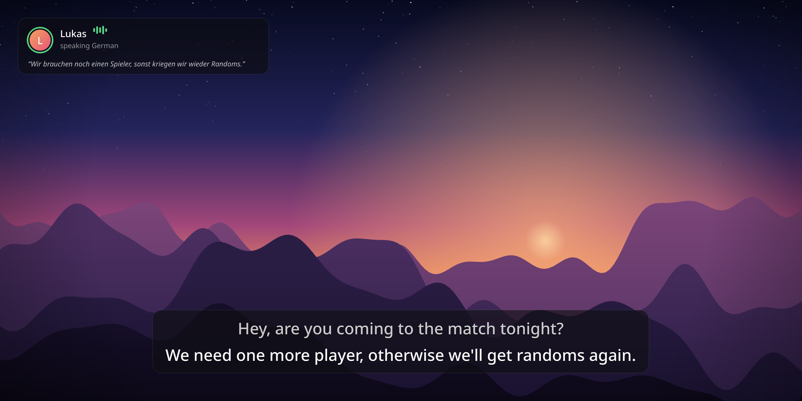

# Call Captions



Live English captions for voice calls. It listens to Discord, translates whatever language
your friends are speaking into English with Whisper, and shows it in a clean, translucent
overlay that fades away on its own. It runs on your graphics card when it can: NVIDIA cards
(GTX 900 series or newer) on Windows and Linux, and the built-in GPU on Apple Silicon Macs.
Otherwise it falls back to the CPU.

## Windows

### Install

1. Download `CallCaptions-Setup-<version>.exe` from the
   [Releases page](../../releases) (or from a build's artifacts on the Actions tab).
2. Run it. The installer isn't code-signed, so Windows may say *"Windows protected your PC"*:
   click **More info → Run anyway**. No admin rights are needed.
3. Call Captions starts and puts a speech-bubble icon in the system tray.

The first launch downloads a few things once, with progress shown on screen:

| What | Size | When |
| --- | --- | --- |
| GPU support (NVIDIA cuBLAS) | 553 MB | only on PCs with an NVIDIA card |
| Speech model | 3.1 GB on 6 GB+ cards, 1.5 GB on 4 GB cards, 0.5 GB otherwise | always |

Needs 64-bit Windows 10 version 2004 or newer, and for GPU speed an NVIDIA driver from
2023 or later (version 528+).

### Using it

Join a voice call; when someone talks, captions appear near the bottom of the screen.
Right-click the tray icon for settings, which are saved and apply immediately:

- **Listen to**: *Discord only* (default; ignores game sound and music) or *Everything I hear*
- **Spoken language**: detected automatically, or pick it for faster, more accurate captions
- **Quality**: *Automatic* picks the best model your graphics card can fit next to a game;
  pick *Balanced* or *Fastest* if a game needs the video memory
- **Position**, **Text size**, **Background**, **Pause captions**, **Start with Windows**

Captions show over windowed and *borderless* fullscreen games. Exclusive fullscreen draws
over everything, so switch the game to borderless if captions don't show.

**Open log** in the tray menu shows a running transcript plus any errors.

To uninstall, use *Settings → Apps → Call Captions*. That also removes the downloaded
models and GPU libraries.

## macOS

Needs an Apple Silicon Mac (M1 or newer) on macOS 14.2 or newer.

### Install

1. Download `CallCaptions-<version>-macOS.dmg` from the [Releases page](../../releases),
   open it, and drag **Call Captions** into **Applications**.
2. Open it. The app isn't notarized by Apple, so the first time macOS says it can't verify it.
   Open **System Settings → Privacy & Security**, scroll down, and click **Open Anyway** next to
   the message about Call Captions.
3. When macOS asks to allow Call Captions to record audio, click **Allow**. That's how it hears
   Discord. (Changed your mind? It's under **Privacy & Security → Screen & System Audio Recording**.)

A speech-bubble icon appears in the menu bar. Click it for the same settings as on Windows,
including **Open at login**. The first launch downloads the speech model once: 3.1 GB on Macs
with 16 GB of memory or more, 1.5 GB on 8 GB Macs. Captions also show over fullscreen apps
and games.

To uninstall, quit the app, delete it from Applications, and delete
`~/Library/Application Support/Call Captions` (that's where the models are).

## Linux

Needs PipeWire (or PulseAudio), Python 3.12 and [uv](https://docs.astral.sh/uv/).

```bash
uv venv --python 3.12 .venv
uv pip install --python .venv/bin/python -r requirements.txt
./captions
```

Flags override the tray settings for one run: `--source all`, `--lang ja`,
`--model medium`, `--position top`, `--file clip.mp3` (needs ffmpeg). See `./captions --help`.

To run from source on a Mac instead, use `requirements-macos.txt`, then
`pip install --no-deps mlx-whisper==0.4.3` (its own dependency list pulls in PyTorch, which
the app doesn't need), and run `python captions.py`. macOS asks Terminal for the audio
recording permission in that case.

## Building the installers

**On GitHub:** the workflow in `.github/workflows/build.yml` builds the Windows installer and
the macOS disk image on every push to `main` and every pull request. Download them from the
run's artifacts. Push a tag like `v1.0.0` to publish a release with both attached.

**On a Windows PC** with Python 3.12 and [Inno Setup 6](https://jrsoftware.org/isdl.php):

```powershell
powershell -ExecutionPolicy Bypass -File packaging\windows\build.ps1 -Version 1.0.0
```

**On an Apple Silicon Mac** with Python 3.12:

```bash
packaging/macos/build.sh 1.0.0
```

Both bundle the app with PyInstaller (`packaging/CallCaptions.spec`), run its self-test
(`--selftest`), then package it: `dist\CallCaptions-Setup-<version>.exe` with Inno Setup on
Windows, `dist/CallCaptions-<version>-macOS.dmg` on macOS.

The image at the top of this README is drawn by the app's own overlay code. To redraw it after
changing the overlay, run `QT_QPA_PLATFORM=offscreen .venv/bin/python packaging/render_preview.py`.

## How it works

| File | Job |
| --- | --- |
| `audio.py` | Captures audio as 16 kHz mono. On Linux it records just Discord's stream (`parec --monitor-stream`) or an output device's monitor. |
| `audio_windows.py` | Windows capture through WASAPI. *Discord only* uses per-app loopback (the API behind OBS's Application Audio Capture) on Discord's process tree. |
| `audio_mac.py` | macOS capture through Core Audio process taps. *Discord only* taps Discord's processes, found by bundle ID. |
| `translator.py` | Detects speech, then translates it with Whisper. A quick pass shows a live preview while someone talks; a careful pass gives the final line when they pause. Also removes Whisper's filler and repeat glitches. |
| `gpu.py` | Picks where Whisper runs (NVIDIA GPU, Apple GPU or CPU), which model fits, and fetches cuBLAS on Windows. |
| `whisper_mlx.py` | Runs Whisper on Apple GPUs with MLX, behind the same interface as faster-whisper. |
| `overlay.py` | The click-through, always-on-top caption box and its animations. |
| `captions.py` | Ties it together: tray menu, settings, logging, self-test. |
